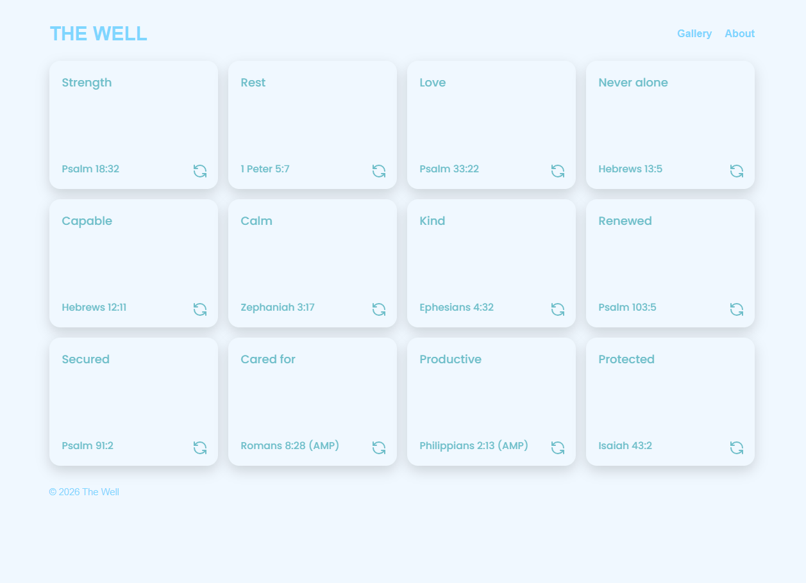

# Gallery 00 -- The Well

**The Well** is a scripture memorization web application developed as an independent front-end practice project, inspired by the Flashcard App project.

The application displays a collection of 12 interactice cards, each featuring a keyword, scripture reference, and corresponding Bible verse. Users can flip the cards to reveal the verses and practice memorizing the verses.

## Features

- A gallery of 12 scripture memorization cards
- Interactive cards with front and back views
- Card-flipping functionality
- A four-column, three-row CSS Grid layout
- A centered desktop layout
- Navigation between application views (Forthcoming)
- Responsive mobile layout (Forthcoming)

## Technologies

- HTML5
- CSS3
- JavaScript
- CSS Grid and Flexbox
- DOM Manipulation

## Screenshots

#### Home Page

#### Card Interaction

