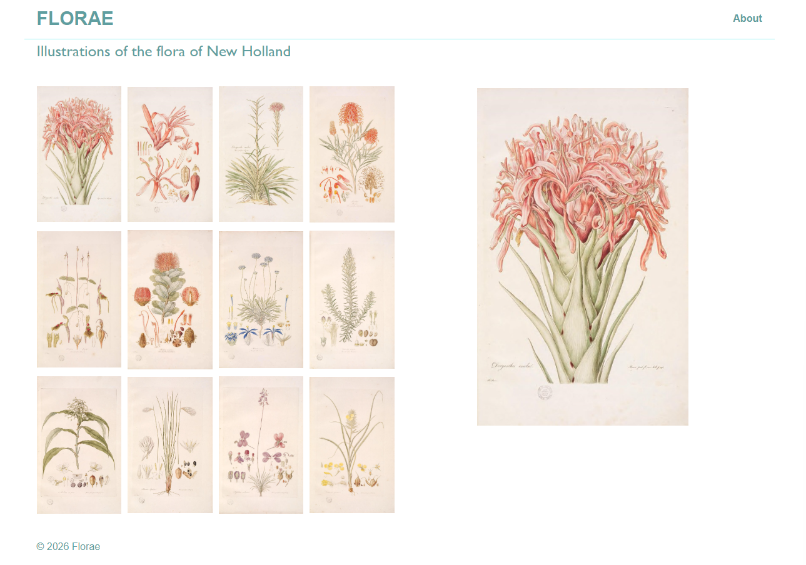

# FLORAE

## Botanical Illustrations

Florae is an interactive botanical illustration gallery featuring artwork by Ferdinand Bauer from 'Illustrations of the Flora of New Holland'.

This project is a personal front-end development exercise focused on practicing CSS layout techniques, including Flexbox, CSS Grid, container alignment, and responsive design.

## Gallery_01: Florae Features | Part 1

- A gallery of 12 botanical illustrations arranged in a 4-column x 3-row grid.
- A featured illustration displayed beside the thumbnail collection.
- A centered page layout with consistent horizontal alignment.
- A desktop interface designed to fit within the browser viewport.

## Technologies

- HTML5
- CSS3
- JavaScript

## Development Status

Work in Progress!
Current focus: refining the desktop gallery layout, image sizing, and viewport alignment.

Forthcoming: interactive thumbnail selection, responsive layouts, and additional gallery functionality.

## Gallery 01 Previews

_Gallery 01 - Initial desktop layout featuring twelve botanical illustrations and a featured image._
